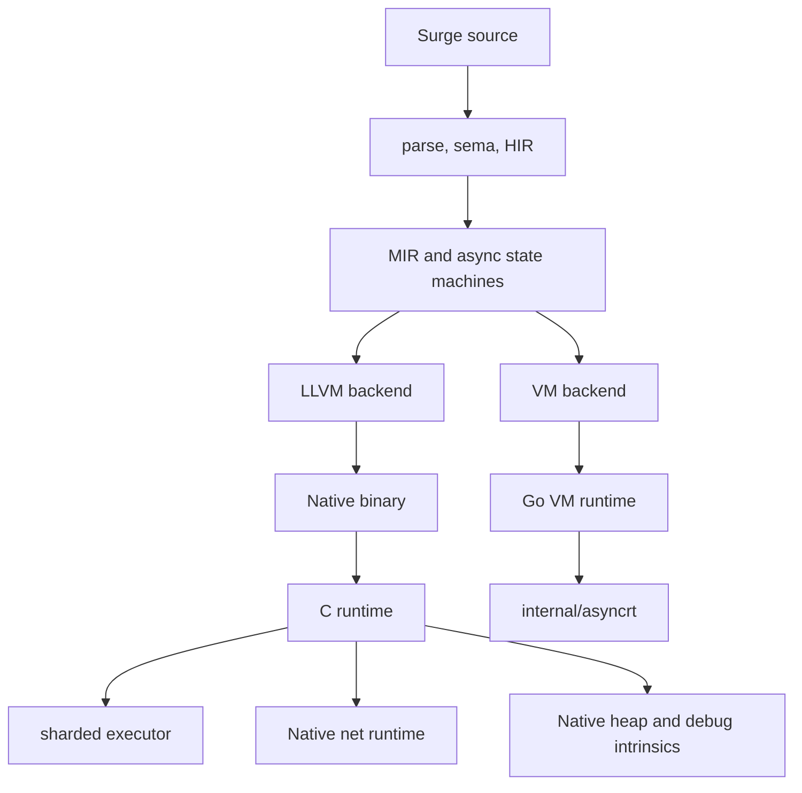
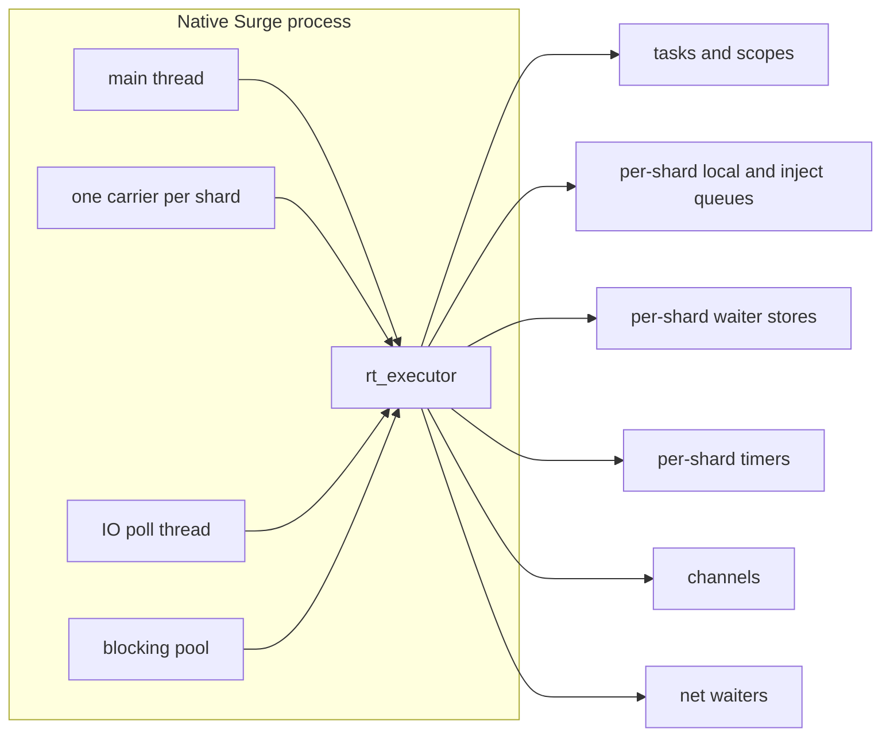
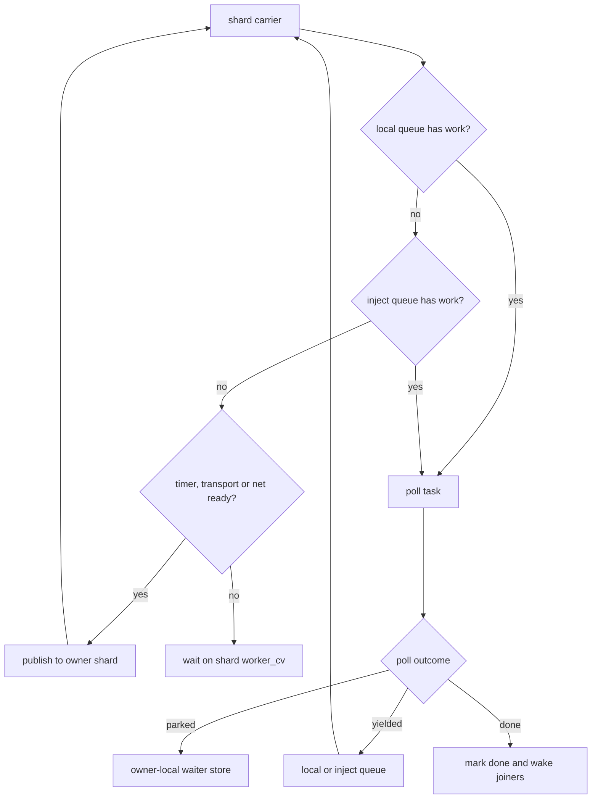
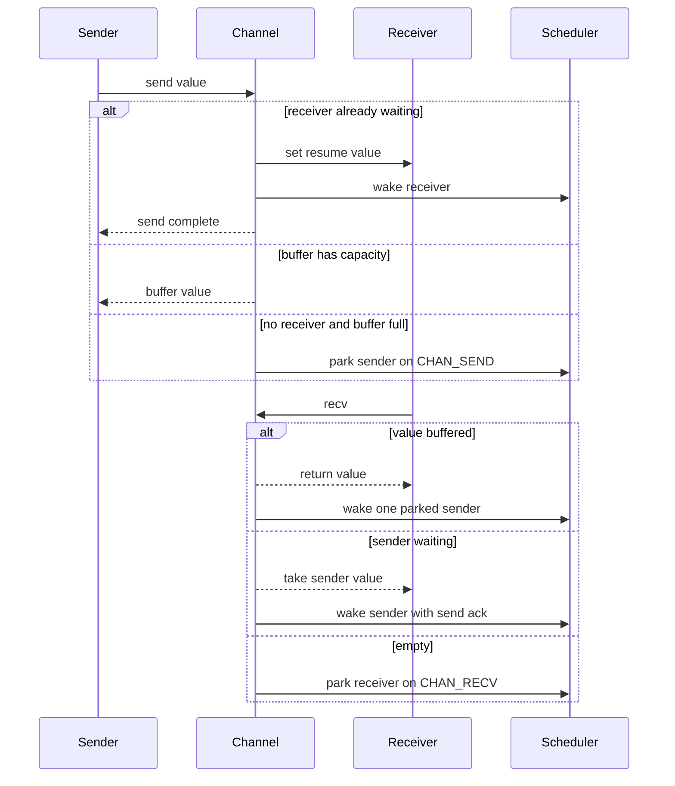

# Surge Runtime
[English](RUNTIME.md) | [Russian](RUNTIME.ru.md)

This document describes the runtime layers that execute already-lowered Surge
programs. Language-level async rules live in `docs/CONCURRENCY.md`; this file is
about the VM and native/LLVM implementation surfaces.

See also: `docs/IR.md`, `docs/CONCURRENCY.md`, `docs/TRACING.md`,
`docs/ABI_LAYOUT.md`.

For the target native runtime direction, see `docs/RUNTIME_V2.md`. That file is
a design target, not a description of the current implementation.

---

## 1. Runtime map

Surge has two execution families:

- **VM backend:** a Go MIR interpreter in `internal/vm`, used for correctness,
  golden tests, diagnostics, deterministic scheduling, and record/replay.
- **Native/LLVM backend:** LLVM emits a binary linked with the C runtime in
  `runtime/native`. This is the production async runtime with `N` shards, one
  carrier per shard, native sockets, a blocking pool, and native heap counters.

The VM and native backends share language semantics, but they do not share the
same scheduler implementation.

| Area | VM | Native/LLVM |
|------|----|-------------|
| Main purpose | diagnostics and parity | production execution |
| Scheduler | single-worker, deterministic by default | N shards, one carrier per shard |
| Async tasks | Go executor over MIR poll state | C executor over compiled poll functions |
| Timers | virtual by default, VM real-time mode exists | executor time |
| Blocking scope | rejected | dedicated blocking pool |
| Network I/O | direct MIR net waiters | native nonblocking sockets plus poll thread |
| Heap debug | VM object heap and RC checks | native allocation counters |

---

## 2. VM runtime

The VM executes MIR directly from `internal/vm`.

- Execution starts at the synthetic `__surge_start` produced from `@entrypoint`
  lowering.
- `VM.Step` interprets MIR instructions and terminators.
- Each call pushes a `Frame` with locals and an instruction pointer.
- Arrays, strings, structs, tagged unions, and owned values live in the VM heap.
- Layout is provided by `layout.LayoutEngine` (see `docs/ABI_LAYOUT.md`).
- Values are dropped explicitly; tests validate drop order and heap leaks.

The host interface is `Runtime` in `internal/vm/runtime.go`:

- `Argv()` provides program arguments for `@entrypoint("argv")`.
- `StdinReadAll()` powers `@entrypoint("stdin")`.
- `EntropyBytes(n)` provides host entropy for `stdlib/entropy`.
- `Exit(code)` records the exit code and stops execution.

Implementations include `DefaultRuntime`, `TestRuntime`, `RecordingRuntime`,
and `ReplayRuntime`.

### 2.1 VM async

VM async execution is handled by `internal/asyncrt`:

- tasks are stackless state machines produced by async lowering;
- the executor is single-threaded and cooperative;
- default scheduling is deterministic FIFO;
- fuzz scheduling can use a fixed seed for reproducible interleavings;
- scopes track structured concurrency and child tasks;
- a call of an `async fn` and an `async { }` block create a task cold
  (`Executor.Create`): recorded, in no ready queue, published by its first
  enqueue and ended unrun if its last handle goes first (RV2-DEBT-370);
- channels, timers, joins, select, race, and cancellation park tasks rather than
  blocking an OS thread.

The VM is the easiest backend for semantic bugs because the scheduler is small
and deterministic. Native-only races and worker-pinning issues still need
native/LLVM tests.

---

## 3. Native/LLVM runtime

The native runtime is C code under `runtime/native`. The compiler emits calls to
runtime entry points for tasks, channels, network I/O, heap diagnostics, terminal
support, and numeric helpers.

Native async state is process-global and lazily initialized on first runtime
use. The central structure is `rt_executor` in `rt_async_internal.h`.

The generated `__surge_start` is an external adapter: it awaits a synthetic
root task and receives only an `int64` exit code. Argument preparation, global
initialization, the user entrypoint activation, and `ExitCode` conversion run
on the root carrier through the ordinary coroutine/frame machinery. This also
applies to synchronous source `fn main()` and to `no_std`; root ABI types are
compiler-owned and do not introduce source-visible declarations.

After normal shutdown has joined the runtime threads, empty scheduler capacity
and table segments are reclaimed. This does not sweep live tasks or scopes.
An admitted blocking job may remain detached as specified by Runtime V2, so
storage still needed by such a job is retained until process exit.

Important executor-owned state:

- segmented task and scope tables: status, state, result, cancellation,
  entitlements, structured-concurrency membership and failfast state;
- per-shard waiter stores keyed by join, timer, channel, net, scope, transport,
  or blocking completion;
- waiter keys that can outlive their task carry the owner shard in the key;
  transport uses a nonzero one-based identity for shard 0, and blocking jobs
  retain their completion key until the worker finishes;
- one `local_queue` and one `inject` queue per shard;
- one `worker_cv` and poller state per shard; `done_cv` is used only by external
  non-task awaiters;
- `blocking_*`: separate pool for `blocking { ... }`.

### 3.1 Task lifecycle

```mermaid
stateDiagram-v2
    [*] --> COLD: create (async fn call, async block)
    COLD --> READY: first spawn, await, cancel or scope join
    COLD --> DONE: last handle dropped, never polled
    COLD --> DONE: cancelled before any start (published, then answered Cancelled at its first poll; body never entered)
    [*] --> READY: create published (blocking, checkpoint, sleep, stand drivers)
    READY --> READY: wake
    READY --> RUNNING: worker polls
    RUNNING --> READY: yields
    RUNNING --> WAITING: parks on waker key
    WAITING --> READY: wake_task
    RUNNING --> DONE: success or cancelled
    WAITING --> DONE: cancellation completes
    DONE --> [*]: last handle released
```

Core invariants:

- A task is never polled concurrently by more than one carrier.
- A task created by a call of an `async fn` or an `async { }` block is cold:
  recorded -- scope membership and owning shard -- and in no ready
  queue until its first `spawn`, await, cancel or scope join publishes it; a
  last handle dropped first ends it without a poll (`rt_task_cold.c`,
  RV2-DEBT-370).
- A cancel that reaches a task while it is cold linearizes before anything
  could start it: the publication it causes records `RT_TASK_CANCELLED_COLD`,
  and the first poll answers `Cancelled()` without entering the body and gives
  the start frame back through `mark_done`. A cancel after the publication is
  cooperative and observed at a suspension, as before.
- In compiled code a scope's implicit join runs after the frame's locals are
  released: a return's drops come first and the join is inserted between them
  and the terminator (`insertScopeJoins`, `internal/mir/async_lowering_state_machine.go`).
  A member that could still read such a local at that join must therefore not
  be runnable there: the task check refuses one that pins a local past its
  block, and a cold member reached by a cancel is answered without running.
- The task owner shard lane serializes ready/waiting transitions. Scope state is
  written only by its owner shard; foreign completions arrive as events. The
  control lane remains for rare process-wide lifecycle work.
- Ready queues store task IDs with the task `enqueued` flag set; duplicate queue
  entries are discarded.
- `wake_token` closes wake-before-park races when a wake arrives while a task is
  preparing to park.
- User poll functions run outside runtime locks; the owner shard lane protects
  the transition into and out of `TASK_RUNNING`.

### 3.2 Scheduling

Native scheduling uses `N` shards with exactly one carrier each. Every shard has
one local LIFO queue and one injection FIFO. There is no Tier 1 peer stealing.

`SURGE_SCHED=seeded` makes the choice between simultaneously non-empty local and
injection queues reproducible for the same seed and external event order. It
does not control OS scheduling, socket readiness, FFI, or blocking-pool timing.

Shard count:

- `SURGE_SHARDS=<n>` selects the number of Tier 1 shards and carriers.
- Without an override, the runtime uses the detected online CPU count, capped at
  64.
- `rt_worker_count()` returns the carrier count, which equals the shard count.
- `SURGE_THREADS` is retired and ignored.

A producer publishes work under the owner shard lane before it signals that
shard. `wake_pending` is a durable shard wake token that closes the
check-to-sleep race; it is not a peer-worker credit.

### 3.3 Channels

Native channels are FIFO handles with optional bounded buffering. Direct channel
operations in async code use task parking:

Direct async channel operations park tasks and return the carrier to scheduler
selection. The compiler must lower `send` and `recv` in a running async task to
those suspendable paths. If generated or handwritten code reaches the blocking
channel ABI while a task is running, native fails closed with
`channel send requires async lowering` or `channel recv requires async lowering`;
the VM enforces the same boundary. External synchronous callers may still use
the blocking helpers because they do not pin a Tier 1 carrier.

There are no compensation workers and no task-context synchronous compatibility
path.

### 3.4 Network I/O

Network readiness waits park the current async task directly:

- `rt_net_wait_accept`, `rt_net_wait_readable`, and `rt_net_wait_writable` are
  suspendable intrinsics lowered into ready/pending poll branches.
- The runtime first tries `poll(..., timeout=0)` on the fd.
- If the fd is not ready, the current task parks on a net waker key.
- The I/O thread watches registered net waiters with `poll`.
- When an fd is ready, it wakes the matching parked tasks.

These waits do not allocate `Task<nothing>` handles and do not add a join layer
between socket readiness and the user task.

The I/O thread is signaled when the executor becomes idle, when net waiters are
registered, or when shutdown changes. `TRACE_NET` counters are emitted as part
of execution tracing.

### 3.5 Blocking pool

`blocking { ... }` runs outside executor workers:

- the block becomes a `TASK_KIND_BLOCKING` task;
- work is submitted to a dedicated blocking pool;
- the async task awaits completion through a blocking waker key;
- cancellation is best-effort because the underlying OS call may not be
  preemptable.

Pool size defaults to the Tier 1 carrier count and can be overridden with
`SURGE_BLOCKING_THREADS=<n>`.

### 3.6 Heap and debug intrinsics

Native allocations go through `rt_alloc`, `rt_free`, and `rt_realloc`. The
runtime tracks allocation count, free count, live blocks, and live bytes. The
`rt_heap_stats()` intrinsic exposes these counters.

The VM has its own heap model and exposes equivalent debug-facing behavior where
possible, but the native counters describe native allocation traffic only.

---

## 4. Runtime tracing

Runtime tracing is separate from compiler tracing in `docs/TRACING.md`.

| Control | Effect |
|---------|--------|
| `SURGE_TRACE_EXEC=1` | emits `TRACE_EXEC`, `TRACE_EXEC_SNAPSHOT`, and `TRACE_NET` lines to stderr |
| `SIGUSR1` with `SURGE_TRACE_EXEC=1` | requests a live execution snapshot on supported platforms |
| `SURGE_SCHED_TRACE=1` | emits `SCHED_TRACE` summary lines |
| `SURGE_SCHED=seeded` | enables seeded scheduler decisions |
| `SURGE_SCHED_SEED=<n>` | sets the seeded scheduler seed |
| `SURGE_ASYNC_DEBUG=1` | enables verbose native async debug prints |
| `SURGE_CHANNEL_WAKE_INJECT=1` | forces channel wake placement through inject for experiments |

Useful `TRACE_EXEC` fields:

- `wake_called`, `wake_enqueued`, `park_attempt`, `park_committed`: wake/park
  activity.
- `channel_handoff_yield`: direct async channel handoff yields.
- `waiters_*`, `tasks_*`, `local_total`, `inject_len`: scheduler shape at a
  snapshot.

Useful `SCHED_TRACE` fields:

- `local`, `inject`: how many tasks were popped from the shard-local queue or
  the shard injection queue.
- `events`: total scheduler pops covered by the summary line.

Useful `TRACE_NET` fields:

- `io_poll_calls`, `io_poll_timeouts`, `io_poll_timeout_max_ms`;
- `io_poll_wake_fd`, `io_poll_net_ready`, `io_poll_errors`;
- `io_poll_waiters_last`, `io_poll_waiters_max`, `io_poll_waiters_total`;
- `io_direct_waits`: direct task parks for network readiness;
- `io_waiter_scan_entries`, `io_waiter_net_entries`: generic waiter-list scan
  cost for net polling;
- `io_poll_rebuilds`, `io_poll_allocs`, `io_poll_dedup_checks`: current poll
  set rebuild cost;
- `io_waiter_complete_calls`, `io_waiter_completed`: net readiness wake/remove
  activity.

Task-context channel send and receive must use async lowering. A synchronous
channel ABI call from a running task fails immediately; it has no trace-only
fallback.

---

## 5. Troubleshooting runtime issues

Start with the smallest layer that reproduces the symptom.

1. **Backend check:** run the same program on VM and native/LLVM when possible.
   VM-only failure usually points at MIR/semantics; native-only failure usually
   points at the C runtime, LLVM lowering, or real I/O.
2. **Shard count:** compare `SURGE_SHARDS=1`, `2`, and `8`; every row still has
   one carrier per shard.
3. **Trace counters:** run with `SURGE_TRACE_EXEC=1` and inspect channel,
   waiter, queue, transport, and net counters.
4. **Scheduler mode:** use `SURGE_SCHED=seeded SURGE_SCHED_SEED=<n>` for
   reproducible scheduler choices. Do not expect it to make external I/O fully
   reproducible.
5. **Channel path:** an `async lowering` panic means a sync helper hid a
   channel operation from suspension lowering; fix the helper or its call site.
6. **Network path:** if net latency remains after channel counters look clean,
   compare a tiny native echo/accept program before blaming application logic.

---

## 6. Current limitations

- VM remains single-worker by design.
- Native/LLVM scheduling across shards is not globally deterministic.
- Seeded scheduling is best-effort and depends on external event order.
- Waiter stores are owner-shard local, but cross-shard completion ordering still
  depends on transport arrival order.
- Synchronous channel send/receive from a running task is unsupported and
  refused; async lowering is required.
- `parallel map/reduce` and `signal` remain reserved language features.
